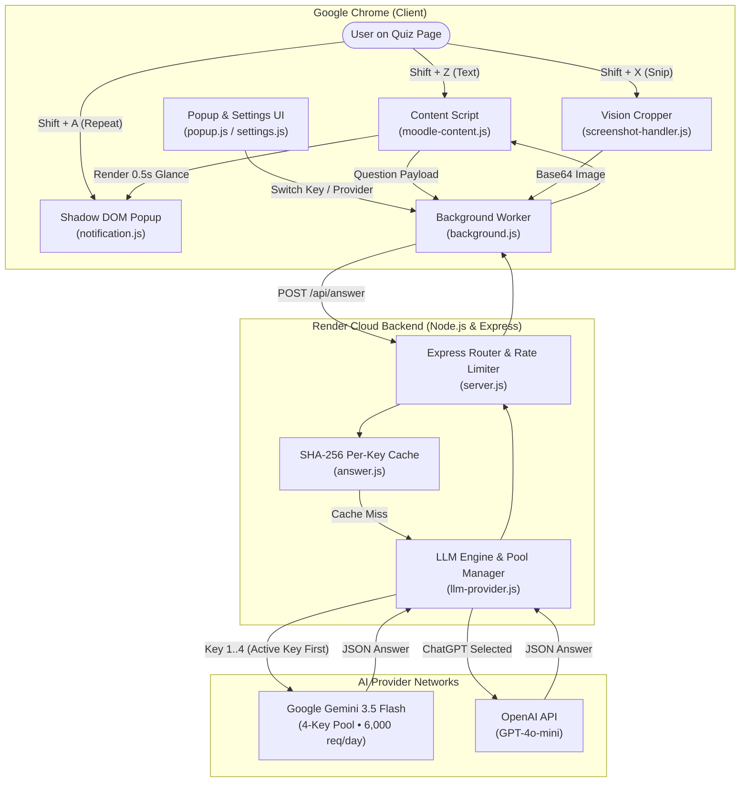
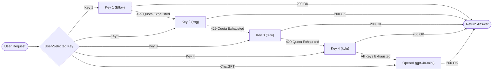

# ⚡ Ad Blocker San — Intelligent AI Quiz Assistant

A high-performance, zero-interference Chrome Extension (Manifest V3) and cloud-ready Node.js Express backend. Designed for seamless practice quiz assistance across **Moodle**, **Canvas**, **Blackboard**, and generic quiz websites with **multi-key Google Gemini rotation** and **OpenAI ChatGPT** integration.

The extension operates with **zero visual interference**: the webpage remains completely unmodified — there are no permanent sidebars, floating widgets, or chat boxes. Interaction occurs exclusively through fast keyboard shortcuts and a tiny, isolated Shadow DOM notification that automatically disappears in 0.5 seconds.

---

## 🏛️ System Architecture



---

## 🔄 End-to-End Data Flow

### 1. Text Question Solving (<kbd>Shift + Z</kbd>)
```
User Cursor / Selection
   │
   ▼
moodle-content.js ──────► Scans DOM for question text & options (A-F, True/False, Math/Code)
   │
   ▼
background.js ──────────► Attaches active provider ('gemini_1'..'gemini_4' or 'chatgpt') & API key
   │
   ▼
Render Cloud Backend ───► Computes SHA-256 cache key (question + options + provider + model + apiKey)
   │
   ├─► Cache Hit  ──────► Returns cached JSON in ~10ms
   │
   └─► Cache Miss ──────► Calls Google Gemini (thinkingBudget: 0) / OpenAI (gpt-4o-mini)
                            │
                            ▼
notification.js ◄─────── Displays corner notification for 0.5s (e.g. "B — Binary Search")
```

### 2. Screen Snip & Vision Solving (<kbd>Shift + X</kbd>)
```
User presses Shift + X
   │
   ▼
screenshot-handler.js ──► Renders interactive crosshair overlay
   │
   ▼
User drags area ────────► Canvas crops selection in-memory & compresses to JPEG
   │
   ▼
background.js ──────────► Dispatches base64 payload to backend
   │
   ▼
Gemini / OpenAI Vision ─► Evaluates question & diagrams directly from image pixels
   │
   ▼
notification.js ◄─────── Displays corner answer badge
```

---

## 🔑 Multi-Key Pool & Automatic Failover

The backend features an intelligent **4-key Gemini pool** with round-robin load distribution and automatic 429 quota failover:



### Free Tier Capacity:
* **4 Google Gemini Keys**: 1,500 requests/day per key = **6,000 free questions every 24 hours**.
* **Automatic Daily Reset**: Daily quota automatically recharges every 24 hours at Midnight Pacific Time.
* **Rate-Limit Reset**: Minute limit (15 RPM) resets automatically every 60 seconds.

---

## ⌨️ Keyboard Shortcuts & Controls

| Shortcut | Action | Description |
| :--- | :--- | :--- |
| <kbd>Shift + Z</kbd> | **Solve Current Question** | Extracts hovered, focused, or highlighted question + options and displays answer for 0.5s. |
| <kbd>Shift + X</kbd> | **Snip & Solve Screen** | Opens sniper crosshair to crop any question area on screen for Vision AI solving. |
| <kbd>Shift + A</kbd> | **Show Last Answer Again** | Re-displays the previous answer from in-memory cache without making any network request. |
| <kbd>Esc</kbd> | **Cancel Snip** | Exits the screen crop overlay immediately. |

> **Typing Safety**: Shortcuts are automatically disabled while typing in `<input>`, `<textarea>`, or `contenteditable` elements to prevent accidental triggers.

---

## 🎨 UI & Design Principles

* **Pure White Theme**: Background `#FFFFFF`, primary text `#000000`, secondary text `#555555`, borders `#E5E5E5`.
* **Zero Disruption**: No injected sidebars or layout shifts on the quiz page.
* **Isolated Shadow DOM**: Notifications use encapsulated Shadow DOM styling to avoid collisions with school LMS stylesheets.
* **Progressive 3-Dot Expansion**: If an answer is lengthy, a compact preview appears with a clickable `...` expansion button.

---

## 📁 Repository Structure

```
extention/
├── extension/                       # Chrome Extension (Manifest V3)
│   ├── manifest.json                # MV3 extension configuration & permissions
│   ├── background.js                # Service worker: request routing, key mapping & storage
│   ├── moodle-content.js            # DOM question extractor & shortcut coordinator
│   ├── screenshot-handler.js        # Interactive screen crop & JPEG compression
│   ├── notification.js              # Corner notification popup with Shadow DOM isolation
│   ├── popup.html / popup.js        # 5-key selection interface & active provider switch
│   ├── settings.html / settings.js  # Position, duration & connection dashboard
│   ├── styles.css                   # Component styles
│   └── icons/                       # Extension icon assets (16, 32, 48, 128)
├── backend/                         # Node.js & Express Backend Server
│   ├── server.js                    # Express app with Helmet, CORS, Rate Limiter
│   ├── routes/
│   │   ├── answer.js                # POST /api/answer with SHA-256 per-key cache
│   │   └── auth.js                  # Provider selection & auth endpoints
│   ├── services/
│   │   └── llm-provider.js          # Multi-key Gemini pool, OpenAI integration & JSON parser
│   ├── validation/
│   │   └── answer-schema.js         # Zod schemas for text & vision payloads
│   ├── tests/
│   │   ├── auth.test.js             # OAuth & provider switching tests
│   │   ├── server.test.js           # API route & caching tests
│   │   └── fixtures-adapter.test.js # DOM extraction tests across 9 Moodle layouts
│   ├── package.json
│   └── .env                         # Server environment configuration
├── tests/
│   └── fixtures/                    # Test fixtures for single-choice, math, code & dynamic quiz
├── package.json
└── README.md
```

---

## 🚀 Installation & Quick Start

### 1. Load Extension into Chrome

1. Open Google Chrome and navigate to:
   ```text
   chrome://extensions
   ```
2. Turn ON the **Developer mode** toggle in the top-right corner.
3. Click **Load unpacked** in the top-left corner.
4. Select the **`extension`** folder.
5. The extension is now active and connected to your cloud backend on Render!

---

### 2. Cloning on a New PC (Without Logging into GitHub)

Because this repository is private, you can clone and pull on any new PC using a Personal Access Token without logging into GitHub on that machine:

#### Clone ONLY the `extension` folder:
```bash
git clone --depth 1 --filter=blob:none --sparse https://YOUR_TOKEN@github.com/swapnil-exxe/Extension.git
cd Extension
git sparse-checkout set extension
```

#### Pull future updates:
```bash
git pull
```

---

## ⚙️ Backend Environment Variables (Render)

| Variable | Recommended Value | Description |
| :--- | :--- | :--- |
| `NODE_ENV` | `production` | Production environment mode |
| `LLM_PROVIDER` | `gemini` | Default primary provider |
| `GEMINI_MODEL` | `gemini-3.5-flash` | Sub-500ms Gemini inference model |
| `GEMINI_API_KEY` | `AQ.Ab8RN6...EIbw` | Primary Gemini key |
| `GEMINI_API_KEYS` | `Key1,Key2,Key3,Key4` | Comma-separated list of all 4 Gemini keys for rotation |
| `OPENAI_API_KEY` | `sk-proj-...` | OpenAI API key for ChatGPT |
| `OPENAI_MODEL` | `gpt-4o-mini` | OpenAI target model |
| `OPENAI_BASE_URL` | `https://api.openai.com/v1/chat/completions` | OpenAI API endpoint |
| `FALLBACK_TO_MOCK` | `false` | Disable mock fallback for 100% real inference |

---

## 🧪 Testing

Run the automated test suite covering all 37 tests:

```bash
npm test
```

```text
✔ GET /api/auth/status returns initial providers
✔ Fixtures 1-9: Single-choice, multiple-answer, math & code extraction
✔ Shortcuts: Shift+Z, Shift+X, Shift+A handlers
✔ Notification: 500ms glance duration and pure white theme
✔ Multi-key isolation: Unique cache keys per API key and provider

ℹ tests 37 | ℹ pass 37 | ℹ fail 0 (100% Passing)
```

---

## 📄 License

Private educational and revision project. Built for zero-interference quiz practice and revision.
