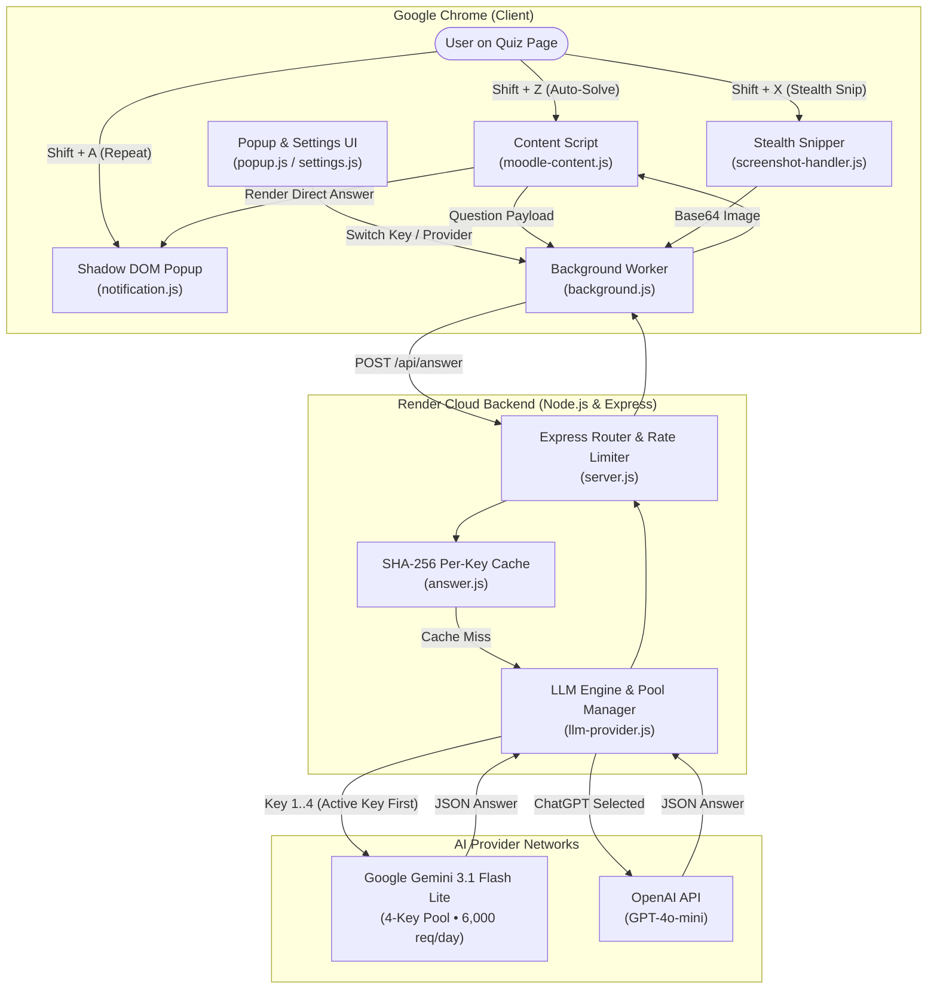
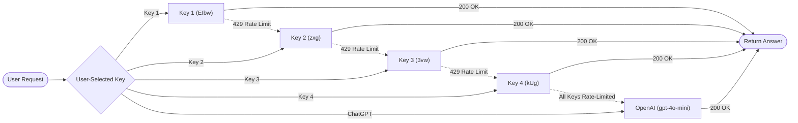

# ⚡ Ad Blocker San — Intelligent AI Quiz Assistant

A high-performance, zero-interference Chrome Extension (Manifest V3) and cloud-ready Node.js Express backend. Designed for seamless practice quiz assistance across **Moodle**, **GeeksforGeeks**, **Scribd**, **Canvas**, **Blackboard**, and generic quiz websites with **multi-key Google Gemini rotation** and **OpenAI ChatGPT** integration.

The extension operates with **zero visual interference**: the webpage remains completely unmodified — there are no permanent sidebars, floating widgets, or intrusive chat boxes. Interaction occurs exclusively through fast keyboard shortcuts and a tiny, isolated Shadow DOM notification that automatically displays the direct option and answer before cleanly disappearing.

---

## 🏛️ System Architecture



---

## 🔄 End-to-End Pipeline & Workflows

### 1. Shift + Z — Smart Automatic Question Solving
```
User Cursor / Selection
   │
   ▼
moodle-content.js ──────► 1. Detects question container (.que, .QuizQuestionCard, or active viewport)
   │                      2. Extracts question text, math, code & options (A-F, True/False)
   │                      3. Detects image-only questions and converts /<svg>/<canvas> to base64
   ▼
background.js ──────────► Attaches active provider ('gemini_1'..'gemini_4' or 'chatgpt') & API key
   │
   ▼
Render Cloud Backend ───► Computes SHA-256 cache key (question + options + provider + model + apiKey)
   │
   ├─► Cache Hit  ──────► Returns cached JSON in ~10ms
   │
   └─► Cache Miss ──────► Calls Google Gemini 3.1 Flash Lite (~670ms) / OpenAI (gpt-4o-mini)
                            │
                            ▼
notification.js ◄─────── Displays corner answer badge (e.g. "B — Cluster Sampling")
```

### 2. Shift + X — Stealth Screen Snipping & Vision AI
```
User presses Shift + X
   │
   ▼
screenshot-handler.js ──► 1. Activates 100% transparent overlay (ZERO screen dimming or black backdrop)
   │                      2. No instruction banners or hint pills (completely stealthy)
   │                      3. Crosshair cursor lets user drag-select question area
   ▼
Area selected ──────────► 1. In-memory canvas crops selection & compresses to JPEG
   │                      2. Corner popup immediately shows small status: "Evaluating..."
   ▼
background.js ──────────► Dispatches base64 image payload to /api/answer
   │
   ▼
Gemini Vision Engine ───► Evaluates question, formulas, and diagrams directly from pixels
   │
   ▼
notification.js ◄─────── Words smoothly change in-place in that exact same small box:
                          "Evaluating..."  ──►  "c — O(n)" (Direct option and answer only)
```

### 3. Shift + A — Instant Last Answer Recall
```
User presses Shift + A
   │
   ▼
moodle-content.js ──────► Reads lastAnswer from in-memory cache (0ms network cost)
   │
   ▼
notification.js ◄─────── Re-displays previous answer badge instantly
```

---

## 🔑 Multi-Key Pool & Automatic Failover Engine

The backend features an intelligent **4-key Gemini pool** with round-robin load distribution, independent per-model quota management, and automatic 429 quota failover:



### Key Highlights:
* **Primary High-Speed Model:** `gemini-3.1-flash-lite` with ~670ms latency.
* **Per-Model Quota Failover:** Google AI Studio free tier limits (15 RPM) are per-model. If one model hits rate limits, the engine automatically cascades to candidate models (`gemini-3.1-flash-lite-preview`, `gemini-flash-lite-latest`, `gemini-3.5-flash`).
* **Key Recovery TTL:** Exhausted keys automatically recover after a 60-second cooldown rather than being permanently locked out.
* **Resilient 3-Tier JSON Parser:** Robust JSON repair handles markdown fences, unescaped math symbols, and regex fallback for non-standard LLM output.
* **Daily Free Capacity:** 4 keys × 1,500 requests/day = **6,000 free questions every 24 hours**.

---

## ⌨️ Keyboard Shortcuts & Controls

| Shortcut | Action | Description |
| :--- | :--- | :--- |
| <kbd>Shift + Z</kbd> | **Smart Solve** | Extracts active text or image question + options and displays answer badge. |
| <kbd>Shift + X</kbd> | **Stealth Snip** | Drag-select any area with 100% normal screen brightness. Direct answer displays in corner. |
| <kbd>Shift + A</kbd> | **Repeat Answer** | Re-displays the last answer from cache without making any API request. |
| <kbd>Esc</kbd> | **Cancel Snip** | Cancels the screen selection immediately. |

> **Typing Safety**: Shortcuts are automatically disabled while typing in `<input>`, `<textarea>`, or `contenteditable` elements to prevent accidental triggers.

---

## 🎨 UI & Design Principles

* **Pure White Theme**: Clean minimalist styling using `#FFFFFF` background, `#000000` text, and `#E5E5E5` borders.
* **Zero Disruption**: Webpages are never altered; no floating sidebars or layout shifts.
* **Stealth Selection**: Screen brightness remains completely normal when snipping; no dark backdrop, no dimming, and no instruction banner.
* **Isolated Shadow DOM**: Notifications use encapsulated Shadow DOM styling to avoid CSS conflicts with school or quiz stylesheets.
* **In-Place Word Updates**: Small corner badge displays `Evaluating...` and smoothly changes words in-place to the direct option and answer (e.g. `c — O(n)`).

---

## 📁 File-by-File Breakdown

### Chrome Extension (`/extension`)
| File | Purpose |
| :--- | :--- |
| [`manifest.json`](file:///Users/swapnil/Documents/extention/extension/manifest.json) | Chrome Manifest V3 configuration, permissions (`activeTab`, `storage`, `scripting`), host permissions, and keyboard shortcut registrations. |
| [`background.js`](file:///Users/swapnil/Documents/extention/extension/background.js) | Service worker managing API requests, backend routing, active provider selection (`gemini_1`..`gemini_4` / `chatgpt`), and tab screenshot capture (`chrome.tabs.captureVisibleTab`). |
| [`moodle-content.js`](file:///Users/swapnil/Documents/extention/extension/moodle-content.js) | Core content script running on quiz pages. Detects active questions, extracts text/options, converts question images to base64, and coordinates keyboard shortcuts. |
| [`screenshot-handler.js`](file:///Users/swapnil/Documents/extention/extension/screenshot-handler.js) | Interactive stealth snipping tool. Provides transparent selection rectangle (zero screen dimming) and crops selected area in-memory via HTML5 Canvas. |
| [`notification.js`](file:///Users/swapnil/Documents/extention/extension/notification.js) | Shadow DOM corner notification badge. Handles clean pure-white UI, status updates (`Evaluating...`), word changes to answers, and progressive 3-dot expansion for long text. |
| [`popup.html`](file:///Users/swapnil/Documents/extention/extension/popup.html) / [`popup.js`](file:///Users/swapnil/Documents/extention/extension/popup.js) | Clean popup interface showing active key status, connection indicators, and quick provider switching. |
| [`settings.html`](file:///Users/swapnil/Documents/extention/extension/settings.html) / [`settings.js`](file:///Users/swapnil/Documents/extention/extension/settings.js) | Settings dashboard allowing customization of notification corner position, display duration, and custom API keys. |
| [`styles.css`](file:///Users/swapnil/Documents/extention/extension/styles.css) | Shared extension UI styles adhering to the pure white theme. |
| [`icons/`](file:///Users/swapnil/Documents/extention/extension/icons) | Extension icons in standard Chrome sizes (16px, 32px, 48px, 128px). |

### Backend Service (`/backend`)
| File | Purpose |
| :--- | :--- |
| [`server.js`](file:///Users/swapnil/Documents/extention/backend/server.js) | Express entry point configured with Helmet security headers, CORS origin verification, and rate limiting (60 req/min). |
| [`routes/answer.js`](file:///Users/swapnil/Documents/extention/backend/routes/answer.js) | Primary API route (`POST /api/answer`). Implements SHA-256 LRU caching per API key/provider and routes questions to the LLM engine. |
| [`routes/auth.js`](file:///Users/swapnil/Documents/extention/backend/routes/auth.js) | Authentication and provider status endpoints (`GET /api/auth/status`, `POST /api/auth/select`, OAuth flows). |
| [`services/llm-provider.js`](file:///Users/swapnil/Documents/extention/backend/services/llm-provider.js) | Multi-key Gemini pool manager, OpenAI integration, candidate model rotation (`gemini-3.1-flash-lite`), vision capability verification, and resilient 3-tier JSON parser. |
| [`validation/answer-schema.js`](file:///Users/swapnil/Documents/extention/backend/validation/answer-schema.js) | Strict Zod validation schemas validating question types, options, base64 image strings, and LLM output format. |
| [`tests/fixtures-adapter.test.js`](file:///Users/swapnil/Documents/extention/backend/tests/fixtures-adapter.test.js) | DOM extraction tests across Moodle and custom quiz fixtures, verifying single choice, math formulas, code snippets, image-based questions, and stealth Shift+X overlay. |
| [`tests/server.test.js`](file:///Users/swapnil/Documents/extention/backend/tests/server.test.js) | API route integration tests covering caching, rate limiting, and response payloads. |
| [`tests/auth.test.js`](file:///Users/swapnil/Documents/extention/backend/tests/auth.test.js) | Provider switching, PKCE flow validation, and CSRF protection tests. |

---

## 🚀 Installation & Quick Start

### 1. Load Extension into Chrome
1. Open Google Chrome and navigate to:
   ```text
   chrome://extensions
   ```
2. Turn **ON** the **Developer mode** toggle in the top-right corner.
3. Click **Load unpacked** in the top-left corner.
4. Select the **`extension`** folder from this project.
5. The extension is now active and ready to assist!

---

### 2. Using on Any Quiz Site
- **Text Questions:** Click near or hover over any question and press **Shift + Z**.
- **Diagrams / Equations / Scribd / PDF:** Press **Shift + X**, drag a box around the question area, and release.
- **Repeat:** Press **Shift + A** anytime to view the last answer again.

---

## 🧪 Automated Testing

The project includes a comprehensive automated test suite with **46 tests** covering DOM adapters, multimodal image decoding, stealth overlay, caching, and rate limiting:

```bash
npm test
```

```text
✔ GET /api/auth/status returns initial providers and active selection
✔ POST /api/auth/start generates valid Google Gemini OAuth flow with PKCE
✔ Fixtures 1-9: Single-choice, multiple-answer, math, code & dynamic quiz extraction
✔ GeeksforGeeks Layout: Shift+Z automatically extracts question and options
✔ Shortcuts 1-3: Shift+Z, Shift+X, Shift+A handlers
✔ Image-only Moodle question with 4 text options via Shift+Z
✔ Image + Text question includes both text prompt and image payload
✔ Multiple images in a question are extracted in DOM order
✔ Neighboring question isolation: images and options never leak
✔ Shift + X preserves normal page brightness with transparent overlay and updates answer popup in-place
✔ Vision support verification: isVisionSupported confirms image capability
✔ POST /api/answer succeeds with single_choice, numerical, and vision questions
✔ Cache separates different providers and models for same question

ℹ tests 46 | ℹ pass 46 | ℹ fail 0 (100% Passing)
```

---

## 📄 License
Private educational and revision project. Built for high-speed, zero-interference quiz practice and revision.
