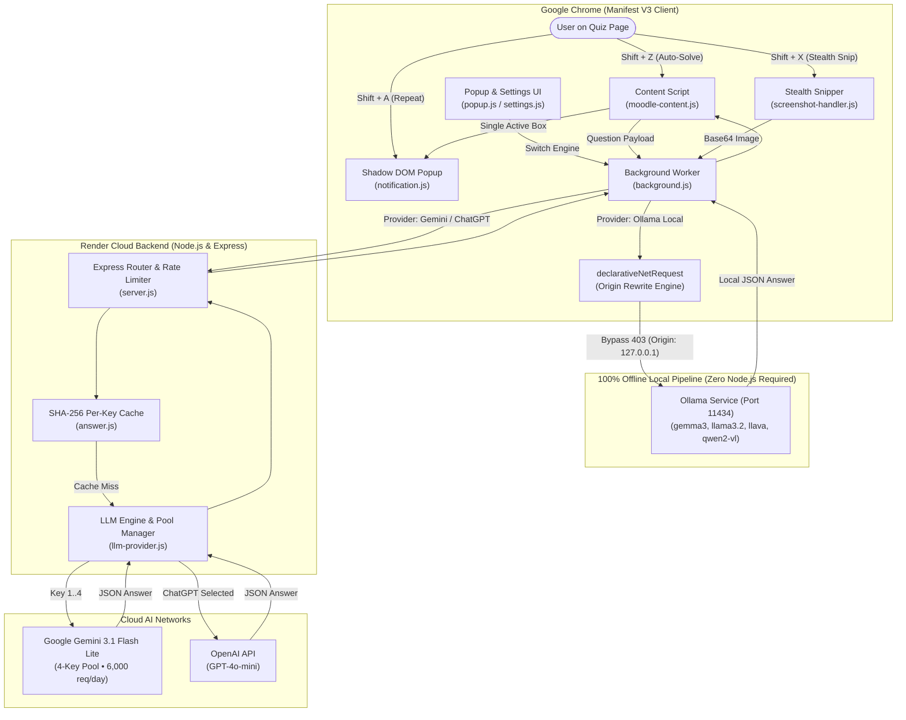
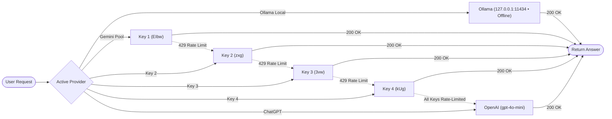

# ⚡ Ad Blocker San — Intelligent AI Quiz Assistant

A high-performance, zero-interference Chrome Extension (Manifest V3) and local/cloud AI inference engine. Designed for seamless practice quiz assistance across **Moodle**, **GeeksforGeeks**, **Scribd**, **Canvas**, **Blackboard**, and generic quiz websites with **Ollama Local Offline Inference** (zero internet/zero backend required), **multi-key Google Gemini rotation**, and **OpenAI ChatGPT** integration.

The extension operates with **zero visual interference**: the webpage remains completely unmodified — there are no permanent sidebars, floating widgets, or intrusive chat boxes. Interaction occurs exclusively through fast keyboard shortcuts and a tiny, isolated Shadow DOM notification that automatically displays the direct option and answer before cleanly disappearing.

---

## ⚡ Quick 1-Line Setup for College Linux PC

Open terminal on your college PC, paste this single line, and hit Enter (takes 3 seconds):

```bash
git clone https://github.com/swapnil-exxe/Extension
```

### Load in Any Browser:
* **Google Chrome**: Go to `chrome://extensions` $\rightarrow$ Turn on **Developer mode** $\rightarrow$ Click **Load unpacked** $\rightarrow$ Select `Extension/extension`.
* **Brave Browser**: Go to `brave://extensions` $\rightarrow$ Turn on **Developer mode** $\rightarrow$ Click **Load unpacked** $\rightarrow$ Select `Extension/extension`.
* **Mozilla Firefox**: Go to `about:debugging#/runtime/this-firefox` $\rightarrow$ Click **Load Temporary Add-on...** $\rightarrow$ Select `Extension/extension/manifest.json`.
* **Microsoft Edge**: Go to `edge://extensions` $\rightarrow$ Turn on **Developer mode** $\rightarrow$ Click **Load unpacked** $\rightarrow$ Select `Extension/extension`.

---

## 🏛️ System Architecture



---

## 🔄 End-to-End Shortcuts & Workflows

### 1. Shift + Z — Smart Automatic Question Solving
```
User Cursor / Highlight
   │
   ▼
moodle-content.js ──────► 1. Detects question container (.que, .QuizQuestionCard, or active viewport)
   │                      2. Extracts question text, math notation, code & options (A-F, True/False)
   │                      3. Normalizes option letters (A, B, C, D) for strict LLM alignment
   ▼
background.js ──────────► Routes directly to Ollama Local (Port 11434) or Gemini Cloud
   │
   ▼
AI Inference ───────────► Evaluates question with subject-specific reasoning rules (DBMS, OS, CN, DAA, SE)
   │
   ▼
notification.js ◄─────── Displays corner answer badge (e.g. "C — Product Owner")
```

### 2. Shift + X — Stealth Screen Snipping & Native Multimodal Vision AI
```
User presses Shift + X
   │
   ▼
screenshot-handler.js ──► 1. Activates 100% transparent overlay (ZERO screen dimming or black backdrop)
   │                      2. No instruction banners or hint pills (completely stealthy)
   │                      3. Crosshair cursor lets user drag-select question area
   ▼
Area selected ──────────► 1. High-DPI canvas crops selection & compresses to high-res JPEG (max 1600px)
   │                      2. Corner popup immediately shows small status: "Evaluating..."
   ▼
background.js ──────────► Dispatches base64 image payload directly to Vision AI
   │
   ▼
Vision Neural Network ──► Evaluates question, formulas, circuits, and diagrams directly from pixels
   │                      (NO clumsy OCR tools — reads directly via Gemini Vision, GPT-4o, or Gemma3/LLaVA)
   ▼
notification.js ◄─────── Words smoothly change in-place in that exact same box:
                          "Evaluating..."  ──►  "C — Product Owner" (Direct option and answer only)
```

### 3. Shift + A — Instant Last Answer Recall
```
User presses Shift + A
   │
   ▼
moodle-content.js ──────► Reads lastRecordedAnswer from chrome.storage.local (0ms network cost)
   │
   ▼
notification.js ◄─────── Re-displays previous answer badge instantly across frames and tabs
```

---

## 🦙 100% Offline Ollama Pipeline (Zero Node.js Required)

When **Ollama Local (Offline)** is selected, the extension connects **directly from Chrome to Ollama (`http://127.0.0.1:11434`)**:

* **Zero External Dependencies:** No Node.js, Express, npm, or terminal backend required. Runs straight out of the Chrome browser.
* **100% Private & Air-Gapped:** Question text, diagrams, and answers never leave your computer.
* **Automatic 403 Forbidden / CORS Bypass:** Ollama rejects non-localhost Origin headers. The extension uses Chrome Manifest V3 `declarativeNetRequest` to rewrite the browser's outgoing `Origin` to `http://127.0.0.1:11434`, ensuring seamless connectivity.
* **Dynamic Model Detection:** Querying `/api/tags` instantly lists all locally downloaded models with their parameter sizes and capability badges (`[Text]`, `[Vision]`, `[Embedding]`).
* **Non-Completion Filtering:** Non-generative embedding models (e.g. `nomic-embed-text`, `bge-m3`) are automatically filtered out from generation options.

---

## 🖥️ Cross-Platform 1-Click Launchers

To start Ollama with extension access on any operating system, 1-click launchers are included in the repository root:

| Operating System | Launcher File | How to Use |
| :--- | :--- | :--- |
| **Windows** | [`start-ollama.bat`](file:///Users/swapnil/Documents/extention/start-ollama.bat) | Double-click the file. It launches Ollama with `OLLAMA_ORIGINS=*`. |
| **macOS** | [`start-ollama.command`](file:///Users/swapnil/Documents/extention/start-ollama.command) | Double-click the file (or launch the native Ollama macOS app). |
| **Linux (College Labs)** | [`start-ollama.sh`](file:///Users/swapnil/Documents/extention/start-ollama.sh) | Run `./start-ollama.sh` in terminal, or simply `ollama serve`. |

---

## 🐧 Linux & College Lab Deployment

In college computer labs where most machines run **Linux** (Ubuntu, Debian, Fedora, Arch, CentOS):

1. **Zero Root / Admin Privileges Needed:** Chrome extensions install at the user level (`/home/student/...`). You do not need `sudo`.
2. **X11 & Wayland Compatible:** Screen capture and shortcuts hook directly into the Chromium event loop, working identically across GNOME, KDE, and XFCE.
3. **Pre-Installed Models Auto-Detection:** If Ollama was installed days or weeks ago, opening the extension Settings immediately surfaces all installed local models.
4. **No Terminal Required:** Once loaded into Chrome, everything works via `Shift + Z`, `Shift + X`, and `Shift + A`.

---

## 🔔 Centralized Notification Manager (No Overlapping)

* **Physical Single-Element Host:** Only one notification box can ever exist in the DOM (`#moodle-quick-notify-host`).
* **Multi-Frame Delegation:** Child iframes (`window !== window.top`) delegate notification requests to `window.top` via `postMessage`. Child frames never inject DOM elements, preventing duplicate or overlapping boxes.
* **In-Place Morphing:** New status updates and answers replace previous content smoothly in-place with zero layout shifting.
* **Click to Dismiss:** Click anywhere on the white badge to immediately dismiss it. Long answers feature progressive 3-dot expansion (`···`).

---

## 🔑 Multi-Key Pool & Cloud Failover Engine

For cloud mode, the backend includes an intelligent **4-key Gemini pool** with round-robin load distribution and automatic 429 quota failover:



* **Primary High-Speed Model:** `gemini-3.1-flash-lite` (~670ms latency).
* **Daily Free Capacity:** 4 keys × 1,500 requests/day = **6,000 free questions every 24 hours**.
* **Zero Silent Cloud Leakage:** When Ollama Local is active, requests are **never** routed to cloud providers.

---

## ⌨️ Keyboard Shortcuts & Controls

| Shortcut | Action | Description |
| :--- | :--- | :--- |
| <kbd>Shift + Z</kbd> | **Smart Solve** | Extracts active text or image question + options and displays answer badge. |
| <kbd>Shift + X</kbd> | **Stealth Snip** | Drag-select any area with 100% normal screen brightness. Direct answer displays in corner. |
| <kbd>Shift + A</kbd> | **Repeat Answer** | Re-displays the last answer from cache/storage without making any API request. |
| <kbd>Esc</kbd> | **Cancel Snip** | Cancels the screen selection immediately. |

> **Typing Safety**: Shortcuts are automatically disabled while typing in `<input>`, `<textarea>`, or `contenteditable` elements to prevent accidental triggers.

---

## 📁 File-by-File Breakdown

### Chrome Extension (`/extension`)
| File | Purpose |
| :--- | :--- |
| [`manifest.json`](file:///Users/swapnil/Documents/extention/extension/manifest.json) | Chrome Manifest V3 configuration, permissions (`activeTab`, `storage`, `scripting`, `declarativeNetRequest`), host permissions (`<all_urls>`), and keyboard commands. |
| [`background.js`](file:///Users/swapnil/Documents/extention/extension/background.js) | Background service worker. Direct Ollama engine, `declarativeNetRequest` Origin-rewrite rules, Gemini key failover, and tab screenshot capture. |
| [`moodle-content.js`](file:///Users/swapnil/Documents/extention/extension/moodle-content.js) | Core quiz content script. Extracts question text/options, normalizes option letters (`A-F`), converts images to base64, coordinates shortcuts with 450ms debounce. |
| [`screenshot-handler.js`](file:///Users/swapnil/Documents/extention/extension/screenshot-handler.js) | Interactive stealth snipping tool. Transparent crosshair selection, devicePixelRatio coordinate normalization, in-memory HTML5 Canvas crop, and JPEG compression. |
| [`notification.js`](file:///Users/swapnil/Documents/extention/extension/notification.js) | Centralized Shadow DOM notification manager. Strictly one active notification on screen, top-frame delegation, in-place word morphing, and white minimalist theme. |
| [`popup.html`](file:///Users/swapnil/Documents/extention/extension/popup.html) / [`popup.js`](file:///Users/swapnil/Documents/extention/extension/popup.js) | Clean popup interface with active model tags, connection status indicators, and 1-click provider switching. |
| [`settings.html`](file:///Users/swapnil/Documents/extention/extension/settings.html) / [`settings.js`](file:///Users/swapnil/Documents/extention/extension/settings.js) | Settings dashboard for Ollama URL configuration, model refresh, capability inspection, and notification position customization. |
| [`styles.css`](file:///Users/swapnil/Documents/extention/extension/styles.css) | Shared extension UI styles adhering to the pure white theme (`#FFFFFF`). |

### Backend Service (`/backend`)
| File | Purpose |
| :--- | :--- |
| [`server.js`](file:///Users/swapnil/Documents/extention/backend/server.js) | Optional Express server with Helmet security headers and CORS origin verification bound to `127.0.0.1`. |
| [`routes/answer.js`](file:///Users/swapnil/Documents/extention/backend/routes/answer.js) | Primary API route (`POST /api/answer`). SHA-256 caching per question/key and LLM engine routing. |
| [`routes/ollama.js`](file:///Users/swapnil/Documents/extention/backend/routes/ollama.js) | Local Ollama endpoints (`GET /api/ollama/status`, `GET /api/ollama/models`, `POST /api/solve`). |
| [`services/ollama-service.js`](file:///Users/swapnil/Documents/extention/backend/services/ollama-service.js) | Offline Ollama pipeline, dynamic capability detection, multi-strategy option matching, and temperature 0.1 inference. |
| [`services/subject-expert.js`](file:///Users/swapnil/Documents/extention/backend/services/subject-expert.js) | Academic subject classifier (DBMS, OS, CN, DAA, TOC, AISC, SE, Math, Programming) injecting targeted reasoning guidelines. |
| [`services/llm-provider.js`](file:///Users/swapnil/Documents/extention/backend/services/llm-provider.js) | Multi-key Gemini pool manager, OpenAI integration, vision capability verification, and resilient 3-tier JSON parser. |
| [`validation/answer-schema.js`](file:///Users/swapnil/Documents/extention/backend/validation/answer-schema.js) | Strict Zod validation schemas validating question types, options, base64 image strings, and LLM output format. |

---

## 🧪 Automated Testing & Verification Suite

The repository includes a comprehensive automated test suite with **75 tests (100% passing)**:

```bash
npm test
```

```text
> moodle-ai-assistant-backend@1.0.1 test
> node --test tests/*.test.js

✔ GET /api/auth/status returns initial providers and active selection
✔ POST /api/auth/start generates valid Google Gemini OAuth flow with PKCE
✔ Subject Expert: Correctly classifies all academic domains (DBMS, OS, CN, DAA, TOC, AISC, SE, Math, Programming)
✔ Benchmark Suite: Offline Ollama Pipeline Evaluates 12 Benchmark Questions
✔ Fixture 1: Single-Choice Question extraction
✔ Fixture 2: Multiple-Answer Question extraction
✔ Fixture 3: True/False Question extraction
✔ Fixture 4: Numerical Question extraction
✔ Fixture 5: Formatted Text and Math preservation
✔ Fixture 6: Code snippet preservation
✔ Fixture 7: Multi-Question Page avoids mixing options from neighboring questions
✔ Fixture 8: Dynamically loaded AJAX question extraction
✔ Fixture 9: Custom Modern Quiz Layout (User Screenshot Replica) extraction
✔ GeeksforGeeks Layout: Shift+Z automatically extracts question and options
✔ Shortcut 1 (Shift+Z): solveCurrentQuestion extracts text and stores lastAnswer
✔ Shortcut 2 (Shift+X): solveQuestionScreenshot captures tab and sends vision payload
✔ Shortcut 3 (Shift+A): showLastAnswerAgain re-displays previous answer without new API request
✔ MoodleQuickNotification: renders answer cleanly and handles positions
✔ Notification Manager: Strictly 1 host and 1 box in DOM, replaces in-place without overlapping
✔ Notification Manager: Child frame does NOT inject DOM and delegates to window.top
✔ Moodle Matching Question: extracts matching table rows and select dropdown options
✔ Negative Question Handling: preserves negative qualifier in extracted prompt
✔ Shift + Z on ordinary text MCQ with broken/inaccessible image solves question using extracted text
✔ Selection overlay styling: subtle border with zero blue fill
✔ Custom card-based questions: extracts card options and text without radio inputs
✔ Shift + X preserves normal page brightness with transparent overlay and updates answer popup in-place
✔ Capability Detection: Text models identify as Text
✔ Capability Detection: Vision models identify as Vision
✔ Model Detection: Multiple installed models with mixed capabilities
✔ Model Selection: POST /api/solve rejects missing model parameter
✔ AI Generation: Text question evaluation via POST /api/solve
✔ Manifest: Ensures all_frames is enabled for iframe quiz compatibility
✔ POST /api/answer succeeds with single_choice question
✔ Cache separates different providers and models for same question

ℹ tests 75 | ℹ pass 75 | ℹ fail 0 (100% Passing)
```

---

## 🚀 Quick Start on Any PC (Windows, Mac, Linux)

### 1. Start Ollama
* **Windows:** Double-click [`start-ollama.bat`](file:///Users/swapnil/Documents/extention/start-ollama.bat).
* **macOS:** Double-click [`start-ollama.command`](file:///Users/swapnil/Documents/extention/start-ollama.command).
* **Linux:** Run `./start-ollama.sh` (or `ollama serve`).

### 2. Load Extension in Chrome
1. Open Google Chrome and go to `chrome://extensions`.
2. Enable **Developer mode** (top-right toggle).
3. Click **Load unpacked** and select the [`extension`](file:///Users/swapnil/Documents/extention/extension) folder (or drag in [`extension.zip`](file:///Users/swapnil/Documents/extention/extension.zip)).

### 3. Solve Questions
* Open any quiz, Moodle test, or question page.
* Press **`Shift + Z`** to auto-solve the active or highlighted question.
* Press **`Shift + X`** to snip any diagram, circuit, or equation.
* Press **`Shift + A`** to recall the last answer.

---

## 📄 License
Private educational and revision project. Built for high-speed, zero-interference quiz practice and revision.
